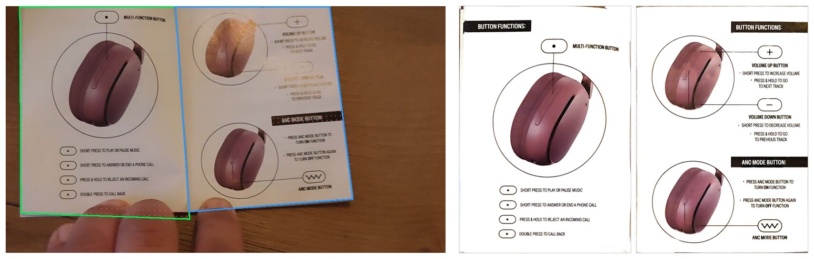
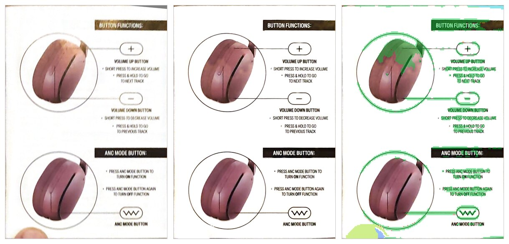
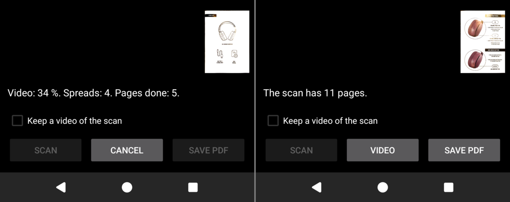

# fastest-scan

Film the pages of a book, a booklet, or a document with a phone. `fastest-scan`
makes a PDF from the video: one page of the PDF for each page of the paper, cropped,
flat, and without the bright reflection of a lamp.



On the left is one frame of a video, with the two pages that the program finds.
On the right are the two pages of the PDF for that spread. A lamp reflects on the
right page of the frame, and fingers hold the booklet. The PDF has the print below
the reflection from other frames of the same spread, and no finger.


A page that is not white paper keeps its colours. Here the left page is the flap
of a cover, and the book lies on a white desk.

The work is in progress. `docs/status.md` says what works today.

## Run

```sh
nix develop            # or direnv, see below
scripts/build.sh
zig-out/bin/fastest-scan video.mp4 -o book.pdf
```

The program needs `ffmpeg` and `ffprobe`. The nix shell has both.

A finger that holds the page in all frames gets the colour of the paper around
it. The program cannot know what is below the finger: text there is lost. Keep the
fingers on the margin of the page. `--fingers blank` paints a finger only when the
paper around it is blank, and `--fingers keep` paints nothing.



From the left: the page from one frame alone, the same page in the PDF, and the
map of its repairs. Green is a reflection that other frames repaired. Yellow-green
is a finger that got the colour of the paper. `--debug-dir DIR` writes such a map
for each page, in `DIR/faults/`, and frames of the video with the page outlines, in
`DIR/frames/`.

## Configure

Each setting is a flag of the program. Run `fastest-scan --help` for the list.
These environment variables set a default for a flag:

| Variable | Flag | Purpose |
|---|---|---|
| `FASTEST_SCAN_FFMPEG` | `--ffmpeg` | The `ffmpeg` program. The default is `ffmpeg`. |
| `FASTEST_SCAN_FFPROBE` | `--ffprobe` | The `ffprobe` program. The default is `ffprobe`. |
| `FASTEST_SCAN_BENCH_VIDEO` | none | The video that `scripts/bench.sh` converts. |

## The Android app

The app in `android/` scans a book with the camera of a phone, or from a recorded
video, and saves the PDF. It uses the same library, in the flow of `--stream`.



The lower part of the screen, on the Android emulator: during the scan of a
recorded video, and after it. The small picture is the last page of the scan. With
the camera, the screen shows the picture of the camera and the outline of each
page.

The scan of a recorded video works on a phone and on the emulator. With the
camera, the app scanned the first pages of one book on a white desk. No scan of a
whole book with the camera is verified yet. `docs/android.md` says how to build
the app, how to test it, and what its limits are.

## Develop

- The dev shell comes from `flake.nix`: `nix develop`.
- With direnv, write these three lines into `.envrc` and run `direnv allow .`:

  ```sh
  source_up_if_exists
  use flake
  dotenv_if_exists .env
  ```

- `scripts/lint.sh` runs all linters. `prek install` adds them as a git hook.
- `scripts/test.sh` runs the unit tests.
- `scripts/test-jni.sh` tests the JNI layer of the Android app on a desktop.
- `scripts/all.sh` runs the two.
- `scripts/bench.sh` converts the benchmark video and prints the quality numbers.

The code has three parts:

- `src/lib/` is the library `fastscan`. It gets frames and gives page images and PDF
  bytes. It has a C interface (`include/fastscan.h`) for an Android app.
- `src/cli/` is the program. It decodes the video with `ffmpeg` and calls the library.
- `android/` is the Android app. It calls the library through the C interface.

The program has two flows. The default reads the video two times and jumps to
the frames that it needs. `--stream` reads the video one time, in order, and
keeps only a few frames in memory: the flow of the Android app.

`docs/decisions/` has the reason for each design decision. `docs/research/` has the
research behind them.

## Release

```sh
scripts/release.sh          # the version comes from the commit messages
git push --follow-tags
```

The script writes the version into `build.zig.zon`, writes `CHANGELOG.md` with
git-cliff, makes the commit, and makes the tag.

## Credits

The method builds on published work. The comment of each algorithm in the code
names its source.

- Z. Zhang and L.-W. He, "Whiteboard scanning and image enhancement," *Digital
  Signal Processing*, vol. 17, no. 2, pp. 414-432, 2007.
  [doi:10.1016/j.dsp.2006.05.006](https://doi.org/10.1016/j.dsp.2006.05.006).
  The page shape from its perspective view, and white paper from a paper colour
  surface.
- Y. He, P. Pan, S. Xie, J. Sun, and S. Naoi, "A book dewarping system by
  boundary-based 3D surface reconstruction," in *Proc. ICDAR*, 2013, pp. 403-407.
  [doi:10.1109/ICDAR.2013.88](https://doi.org/10.1109/ICDAR.2013.88).
  The model of a curled page (the `--curl` option).
- S. W. Hasinoff *et al.*, "Burst photography for high dynamic range and low-light
  imaging on mobile cameras," *ACM Transactions on Graphics*, vol. 35, no. 6, 2016.
  [doi:10.1145/2980179.2980254](https://doi.org/10.1145/2980179.2980254).
  The alignment of two frames by tiles on a pyramid.
- C. Liu, M. Rubinstein, M. Krainin, and B. Freeman, "PhotoScan: Taking glare-free
  pictures of pictures," Google Research blog, 2017.
  <https://research.google/blog/photoscan-taking-glare-free-pictures-of-pictures/>.
  Glare repair from several frames of one subject.
- L.-W. He and Z. Zhang, "Real-time whiteboard capture and processing using a video
  camera for remote collaboration," *IEEE Transactions on Multimedia*, vol. 9,
  no. 1, pp. 198-206, 2007.
  [doi:10.1109/TMM.2006.886385](https://doi.org/10.1109/TMM.2006.886385).
  The comparison of frames on cells.

The complete list, with the standards and the classical algorithms, is in
`docs/references.md`. The same sources as BibTeX are in `docs/references.bib`.

The JPEG encoder is based in part on the work of the Independent JPEG Group.

## License

MIT. See `LICENSE`.
